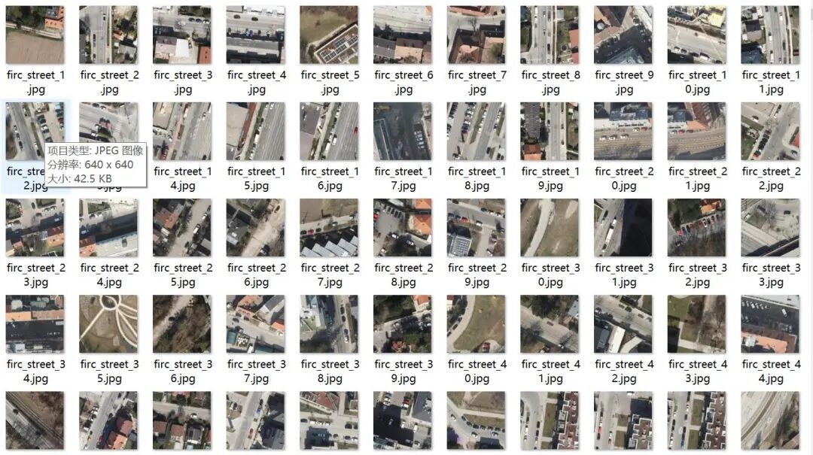
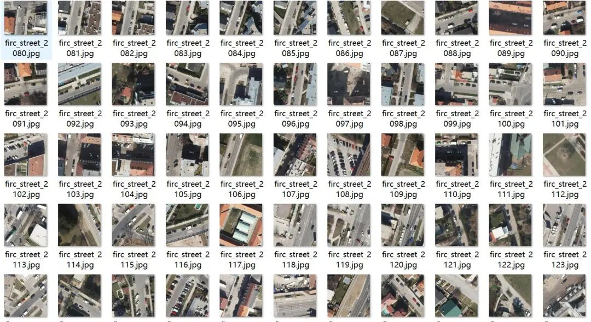
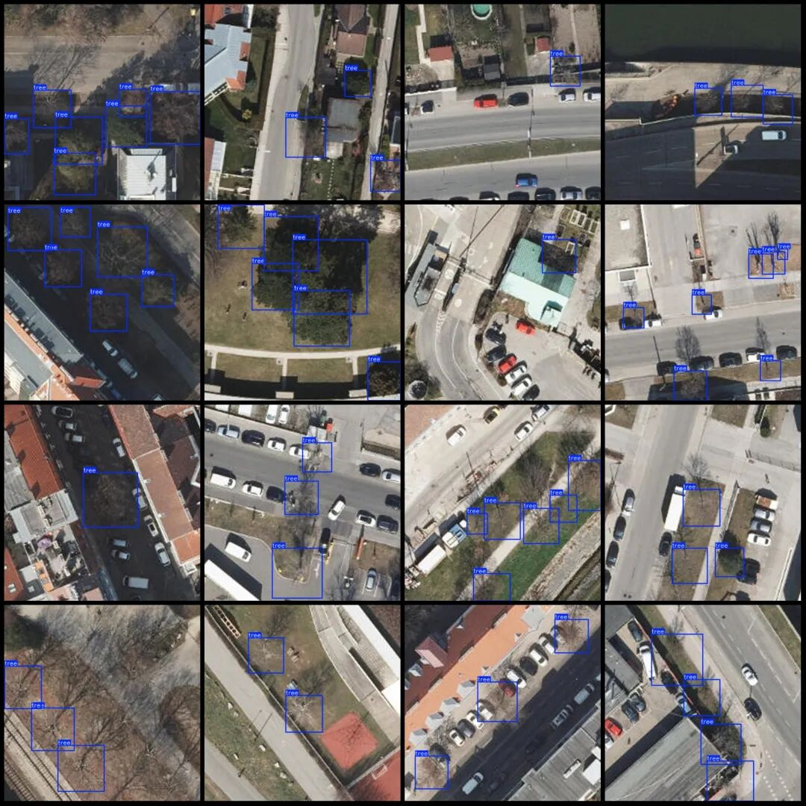
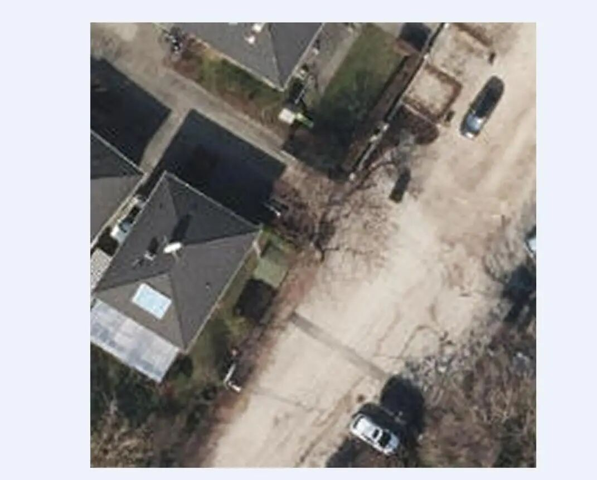

# Dataset for Drone-Viewed Trees on Urban Roadsides in VOC+YOLO format with 3329 images in 1 category

Dataset format: Pascal VOC format + YOLO format (txt file without split path, only containing jpg images and corresponding VOC format xml files and yolo format txt files)

Number of images (number of jpg files): 3329

Number of annotations (number of xml files): 3329

Number of annotations (number of txt files): 3329

Label category count: 1

Drone: DJI MAVIC 3

Height of collection: 120m

Sampling angle: 90°

Label category name (Note that the order of categories in the yolo format does not correspond to this, but is based on the classes.txt file in the labels folder): ["tree"]

Number of boxes labeled in each category:

Number of trees = 10624

Total frames: 10624

Image resolution: 640x640

Using labelImg:

Annotation rules: Draw a rectangle around the category.

Important Notice: No

Special : This dataset does not guarantee the accuracy of the trained models or weight files.

Image Preview:

Annotation examples (randomly select 16 images to show the annotation situation):

Please note that the images in the dataset are not very clear, please refer to the example images below.

## Payment

Here is a pay link on Stripe ( https://buy.stripe.com/3cs8yP7sY87d0vu9AB ). Please contact me lonlonago@foxmail.com after funding $89, and I will send you a complete data files , thank you!

